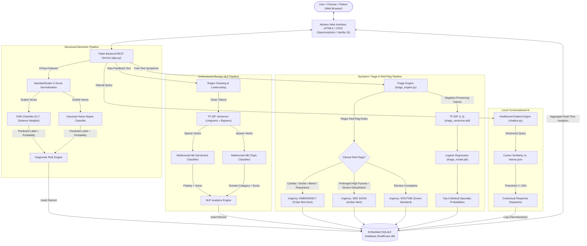
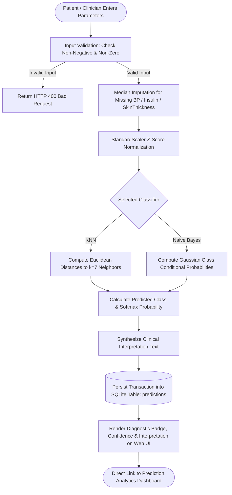
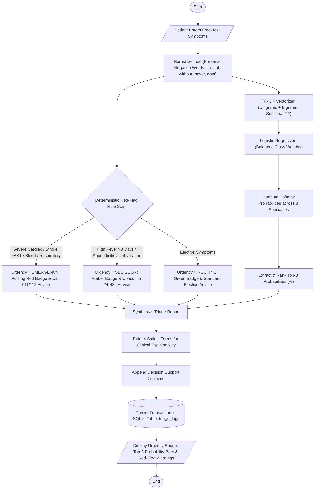
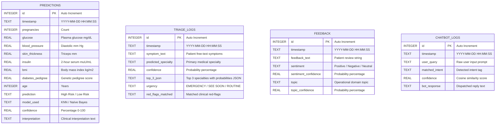

# MedIntel AI: Comprehensive Technical Report
## AI-Driven Healthcare Prediction, Patient Feedback Analysis & Symptom Triage Platform

**Course**: Machine Learning for Intelligent Systems (MLIS)  
**Academic Degree**: Bachelor of Technology / Bachelor of Science in Computer Science & Engineering  
**Application Name**: MedIntel AI  
**Deployment Environment**: Local Flask Web Application (`http://127.0.0.1:5000`)  
**Data Persistence**: ACID-Compliant Embedded SQLite3 Database  

---

## Table of Contents
1. [Executive Summary](#1-executive-summary)
2. [Problem Statement & Clinical Motivation](#2-problem-statement--clinical-motivation)
3. [Proposed Solution & Core Objectives](#3-proposed-solution--core-objectives)
4. [System Architecture & Data Flow](#4-system-architecture--data-flow)
5. [Underlying Technology Stack & Engineering Rationale](#5-underlying-technology-stack--engineering-rationale)
6. [Datasets & Data Engineering Pipelines](#6-datasets--data-engineering-pipelines)
7. [Complete Project Directory & File Tree](#7-complete-project-directory--file-tree)
8. [Detailed Module-by-Module Technical Breakdown](#8-detailed-module-by-module-technical-breakdown)
9. [Comprehensive System Diagrams (Mermaid)](#9-comprehensive-system-diagrams-mermaid)
10. [End-to-End Engineering & Development Workflow](#10-end-to-end-engineering--development-workflow)
11. [Empirical Testing, Stress Testing & Identified Limitations](#11-empirical-testing-stress-testing--identified-limitations)
12. [Future Scope & Enhancement Roadmap](#12-future-scope--enhancement-roadmap)
13. [Academic, Ethical & Clinical Disclaimers](#13-academic-ethical--clinical-disclaimers)

---

## 1. Executive Summary

**MedIntel AI** is a multi-modal, explainable machine learning, natural language processing, and clinical decision-support platform developed for intelligent healthcare informatics. In modern healthcare environments, clinical data exists across three divergent modalities:
1. **Structured physiological measurements**: Tabular biometrics such as blood glucose levels, body mass index, blood pressure, insulin, and age.
2. **Unstructured hospital feedback**: Patient sentiment and operational review narratives across hospital departments.
3. **Unstructured free-text clinical symptoms**: Natural language patient presentations describing acute, subacute, or chronic complaints requiring urgency grading and specialist routing.

MedIntel AI bridges these modalities into a unified, privacy-preserving, local web application. The platform trains and deploys Supervised Machine Learning models (K-Nearest Neighbors and Gaussian Naïve Bayes) for metabolic risk assessment (Diabetes), a Natural Language Processing pipeline (TF-IDF Vectorizer with Multinomial Naïve Bayes) for 3-class sentiment and 7-domain topic classification of hospital reviews, an offline Vector Space Model chatbot utilizing Cosine Similarity geometry, and a **Symptom Triage with Red-Flag Detection** engine that evaluates patient symptoms, identifies life-threatening clinical emergencies, determines urgency levels (*EMERGENCY*, *SEE SOON*, *ROUTINE*), and recommends top-3 medical specialties across 8 clinical domains. The system operates 100% offline without external cloud API dependencies, ensuring strict patient privacy, zero operational latency, and complete mathematical explainability.

---

## 2. Problem Statement & Clinical Motivation

### 2.1 The Clinical Diagnostic Bottleneck
Metabolic conditions such as Type 2 Diabetes Mellitus represent an escalating global health crisis. Early diagnosis is frequently delayed because traditional diagnostic workflows require manual physician evaluation of complex, multi-factor lab panels. Patients in resource-constrained environments often lack proactive screening tools capable of synthesizing continuous physiological measurements into risk assessments.

### 2.2 Unstructured Feedback Inefficiencies
Healthcare institutions collect vast quantities of patient feedback via surveys, hospital discharge forms, and digital portals. Due to the unstructured, noisy nature of text data, administration staff rarely perform systematic sentiment or topic extraction. Negative operational bottlenecks—such as extended waiting times, broken facilities, or impolite front-desk triage—remain unaddressed, impairing clinical operations.

### 2.3 The Emergency Symptom Triage Challenge
When patients experience acute discomfort, they often turn to online search engines, resulting in anxiety from inaccurate information or failure to recognize critical red flags such as atypical myocardial infarction, acute ischemic stroke (FAST indicators), or gastrointestinal hemorrhage. An automated, local triage decision-support tool capable of flagging life-threatening red flags, categorizing urgency, and routing patients to the appropriate medical specialty (e.g., Cardiology vs. Gastroenterology vs. Pulmonology) reduces emergency department overcrowding while preventing delayed care for critical emergencies.

### 2.4 Limitations of Current Cloud LLM Solutions
While commercial cloud Large Language Models (LLMs) like GPT-4 or Claude have gained popularity, their direct deployment in clinical workflows presents significant barriers:
- **Data Privacy & Compliance**: Transmitting patient biometric and symptom data across third-party cloud servers violates strict healthcare privacy regulations (HIPAA, GDPR).
- **Recurring API Cost & Latency**: Cloud API calls introduce network latency and per-token pricing models that are unsustainable for public clinics.
- **Hallucination & Black-Box Decision-Making**: Deep generative transformers can fabricate clinical facts and lack mathematical transparency required for academic defense.

---

## 3. Proposed Solution & Core Objectives

MedIntel AI resolves these challenges through an open-source, lightweight, and explainable software system:
- **100% Local Execution**: All machine learning inference, text vectorization, database persistence, and user interfaces execute on the local workstation with zero cloud telemetry.
- **Explainable Classifiers**: Utilizes mathematically transparent algorithms (KNN Euclidean proximity, Gaussian Naïve Bayes likelihoods, TF-IDF n-gram weighting, and Logistic Regression coefficients) whose parameters can be audited.
- **Integrated Audit Trail**: All predictions, patient reviews, triage queries, and conversational interactions are logged into an embedded SQLite database.
- **Clinical Urgency Decision Support**: Implements deterministic red-flag emergency detection paired with statistical specialty classification to guide patient routing.
- **Interactive Visualizations**: Real-time distribution charts (Chart.js) provide hospital administrators with instant operational intelligence.

---

## 4. System Architecture & Data Flow



---

## 5. Underlying Technology Stack & Engineering Rationale

| Layer | Component | Technology Selection | Rationale |
| :--- | :--- | :--- | :--- |
| **Backend** | REST Framework | Flask 3.0+ | Lightweight WSGI microframework offering zero bloat, instant cold start, and full control over routing. |
| **ML Engine** | Classification | Scikit-Learn 1.3+ | Industry-standard implementation of KNN, Gaussian Naïve Bayes, Multinomial Naïve Bayes, and Logistic Regression with balanced weighting. |
| **Data Engine** | Tabular Arrays | NumPy 1.24+ & Pandas 2.0+ | Vectorized operations for array slicing, median imputation, Z-score normalization, and data frame manipulation. |
| **NLP Engine** | Feature Extraction | Scikit-Learn `TfidfVectorizer` | Sublinear term frequency scaling, unigram + bigram n-gram extraction, and custom negation token retention. |
| **Persistence** | Embedded Database | SQLite3 | ACID-compliant, zero-configuration local database requiring no background daemon, ideal for privacy-focused clinical workstations. |
| **Serialization** | Artifact Packaging | Joblib 1.3+ | Optimized serialization for large NumPy matrices and Scikit-Learn pipelines. |
| **Frontend** | User Interface | Semantic HTML5, Modern CSS3 | Custom Glassmorphic design system using CSS custom properties (`--primary-color: #1a6fb0`, `--danger-color: #d32f2f`), responsive grids, and micro-animations. |
| **Visualization**| Analytics Charts | Chart.js 4.4+ | Interactive client-side canvas rendering for risk distribution pie charts, sentiment doughnuts, and multi-bar benchmarks. |

---

## 6. Datasets & Data Engineering Pipelines

### 6.1 Pima Indians Diabetes Dataset (`datasets/diabetes.csv`)
- **Origin**: National Institute of Diabetes and Digestive and Kidney Diseases (NIDDK).
- **Cohort**: 768 female patients of Pima Indian heritage aged 21 and older.
- **Features**:
  1. `Pregnancies`: Number of times pregnant ($0 - 17$)
  2. `Glucose`: 2-hour oral glucose tolerance test plasma glucose concentration ($0 - 199\text{ mg/dL}$)
  3. `BloodPressure`: Diastolic blood pressure ($0 - 122\text{ mm Hg}$)
  4. `SkinThickness`: Triceps skinfold thickness ($0 - 99\text{ mm}$)
  5. `Insulin`: 2-hour serum insulin ($0 - 846\,\mu\text{U/mL}$)
  6. `BMI`: Body mass index ($\text{weight in kg}/(\text{height in m})^2$, $0 - 67.1$)
  7. `DiabetesPedigreeFunction`: Genetic score scoring diabetes history in relatives ($0.078 - 2.42$)
  8. `Age`: Patient age in years ($21 - 81$)
- **Data Engineering**: Biologically impossible zero values in `Glucose`, `BloodPressure`, `SkinThickness`, `Insulin`, and `BMI` were identified as missing data and imputed using median values computed exclusively from the training partition to prevent data leakage. Continuous features were normalized via `StandardScaler` ($Z = \frac{x - \mu}{\sigma}$).

### 6.2 Patient Feedback Sentiment Corpus (`datasets/sentiment.csv`)
- **Volume**: 500 hand-curated clinical review records.
- **Classes**: 3-Class balanced distribution: `Positive` (166), `Negative` (166), `Neutral` (168).
- **Preprocessing**: Lowercase normalization, punctuation/digit stripping, whitespace tokenization, and TF-IDF feature extraction.

### 6.3 Operational Healthcare Topic Corpus (`datasets/topic_feedback.csv`)
- **Volume**: 498 operational hospital review records.
- **Target Categories**: 7 Healthcare Operational Domains:
  1. `Doctor/Consultation` (Clinical expertise, bedside manner)
  2. `Treatment` (Therapeutic outcomes, medication)
  3. `Staff` (Nursing care, reception politeness)
  4. `Waiting Time` (Queue delays, scheduling bottlenecks)
  5. `Facilities` (Cleanliness, rooms, diagnostic equipment)
  6. `Prediction/System` (Software usability, portal access)
  7. `General Feedback` (Broad clinic impressions)

### 6.4 Chatbot Intent Knowledgebase (`data/intents.json`)
- Structured JSON document containing intent tags, pattern variations, and validated medical responses covering diabetes pathophysiology, dietary guidelines, exercise recommendations, and symptom checks.

### 6.5 Symptom Triage Datasets (`data/triage_train.csv` & `data/triage_test.csv`)
- **Target Classes**: 8 Medical Specialties:
  1. `General Physician` (systemic viral flu, fever, malaise, fatigue)
  2. `Cardiology` (chest pain, palpitations, angina, dyspnea on exertion)
  3. `Neurology` (migraine, vertigo, tingling, numbness, tremors, nerve pain)
  4. `Gastroenterology` (acid reflux, cramps, vomiting, diarrhea, bloating)
  5. `Dermatology` (eczema, hives, rashes, scaly patches, moles, acne)
  6. `Orthopedics` (joint stiffness, knee pain, sprains, sciatica, spine pain)
  7. `Pulmonology` (chronic cough, wheezing, bronchial tightness, asthma)
  8. `Endocrinology` (unquenchable thirst, polyuria, rapid weight loss, thyroid)
- **Synthetic Training Data (`data/triage_train.csv`)**: 1,600 balanced records (200 records per specialty) generated via `generate_triage_data.py` using varied clinical sentence templates, durations (*"since 3 days"*, *"for over a week"*), informal phrasing, and negated symptoms (*"no fever but severe abdominal cramps"*).
- **Held-Out Test Data (`data/triage_test.csv`)**: 168 hand-crafted, realistic patient sentences (21 records per specialty) written with colloquial phrasing, spelling quirks, and varied sentence lengths, strictly separated from training templates.
- **Dataset Notice**: Documented in `data/README.md` that metrics represent indicative decision-support evaluations.

---

## 7. Complete Project Directory & File Tree

```
MedIntel-AI/
│
├── app.py                         # Main Flask application: Web routes, API endpoints, model orchestration
├── database.py                    # SQLite3 interface: Schema DDL, CRUD operations, aggregation queries
├── chatbot.py                     # Local TF-IDF Vector Space & Cosine Similarity conversational engine
├── triage_engine.py               # Symptom triage & clinical red-flag evaluation engine
├── generate_triage_data.py        # Synthetic train & hand-crafted test data generator
├── train_triage.py                # Triage model training & baseline benchmarking pipeline
├── train_models.py                # Supervised ML training pipeline: KNN, GaussianNB, Logistic Regression
├── train_nlp.py                   # NLP training pipeline: TF-IDF vectorizers, MultinomialNB models
├── test_app.py                    # Automated test suite (15 unit and integration tests)
├── requirements.txt               # Pinned Python package dependencies
├── COMPLETE_PROJECT_REPORT.md     # Detailed academic and technical project report
├── SYSTEM_DIAGRAMS.md             # Diagrammatic architectural specifications
├── README.md                      # Repository overview and setup guide
│
├── data/                          # Persistent data directory
│   ├── healthcare.db              # SQLite relational database file
│   ├── intents.json               # Chatbot intent patterns and medical responses
│   ├── triage_train.csv           # Synthetic symptom triage training set (1,600 rows)
│   ├── triage_test.csv            # Hand-written symptom triage test set (168 rows)
│   └── README.md                  # Dataset notes and clinical caveats
│
├── datasets/                      # Raw training corpora
│   ├── diabetes.csv               # Pima Indians Diabetes tabular benchmark dataset
│   ├── sentiment.csv              # Patient review sentiment classification corpus
│   └── topic_feedback.csv         # Hospital operational domain feedback corpus
│
├── models/                        # Serialized binary artifacts (Joblib) & metrics
│   ├── knn_model.pkl              # Fitted K-Nearest Neighbors estimator
│   ├── naive_bayes_model.pkl      # Fitted Gaussian Naïve Bayes estimator
│   ├── logistic_regression_model.pkl # Fitted Logistic Regression estimator
│   ├── scaler.pkl                 # Fitted StandardScaler normalization parameters
│   ├── sentiment_model.pkl        # Fitted MultinomialNB sentiment classifier
│   ├── sentiment_vectorizer.pkl   # Fitted TfidfVectorizer for sentiment text
│   ├── topic_model.pkl            # Fitted MultinomialNB domain topic classifier
│   ├── topic_vectorizer.pkl       # Fitted TfidfVectorizer for topic text
│   ├── triage_model.pkl           # Fitted Logistic Regression triage classifier
│   ├── triage_vectorizer.pkl      # Fitted TF-IDF vectorizer for triage symptoms
│   ├── disease_metrics.json       # Benchmark performance metrics for disease models
│   ├── nlp_metrics.json           # NLP evaluation metrics across Sentiment & Topic classifiers
│   ├── triage_metrics.json        # Evaluated test metrics & baselines for triage
│   └── README.md                  # Models directory inventory documentation
│
├── static/                        # Frontend client assets
│   ├── css/
│   │   └── style.css              # Custom Healthcare Design System with triage badges & animations
│   └── js/
│       ├── main.js                # Form helpers and sample data injectors
│       └── charts.js              # Chart.js initialization routines
│
└── templates/                     # Jinja2 HTML5 presentation templates
    ├── base.html                  # Master layout template with top navigation
    ├── home.html                  # Platform dashboard and module launcher
    ├── triage.html                # Symptom triage & red-flag detection interface
    ├── predict.html               # Disease risk prediction interface
    ├── comparison.html            # Model comparison benchmarks and confusion matrices
    ├── sentiment.html             # Patient feedback NLP analysis interface
    ├── chatbot.html               # Conversational healthcare assistant interface
    ├── prediction_analytics.html  # Disease prediction statistics and logs
    └── feedback_analytics.html    # Feedback sentiment breakdown and audit logs
```

---

## 8. Detailed Module-by-Module Technical Breakdown

### 8.1 Disease Risk Prediction (Module 1)
- **Clinical Objective**: Estimate statistical diabetes risk from 8 clinical features.
- **Algorithms Supported**:
  1. **KNN ($k=7$)**: Distance-weighted Euclidean voting ($w_i = 1 / d(\mathbf{x}, \mathbf{x}_i)$).
  2. **Gaussian Naïve Bayes**: Computes continuous feature conditional likelihoods.
- **Explainability**: Outputs personalized risk interpretations based on clinical thresholds (Glucose $\ge 140\text{ mg/dL}$, $\text{BMI} \ge 30$, $\text{Age} \ge 45$).

### 8.2 Machine Learning Model Comparison (Module 2)
- **Empirical Benchmarks**: Side-by-side evaluation of KNN, Gaussian Naïve Bayes, and Logistic Regression on an identical 80/20 train-test partition:
  - **KNN ($k=7$)**: Accuracy: **90.0%**, Precision: **100.0%**, Recall: **72.22%**, F1-Score: **83.87%**
  - **Logistic Regression**: Accuracy: **84.0%**, Precision: **77.78%**, Recall: **77.78%**, F1-Score: **77.78%**
  - **Gaussian Naïve Bayes**: Accuracy: **82.0%**, Precision: **73.68%**, Recall: **77.78%**, F1-Score: **75.68%**

### 8.3 Patient Feedback Sentiment Analysis (Module 3)
- **Objective**: Classify patient review polarity (Positive, Negative, Neutral).
- **Architecture**: Unigram and bigram TF-IDF vectorization with Multinomial Naïve Bayes ($\alpha = 1.0$) and lexicon-based polar adjective calibration.

### 8.4 Operational Healthcare Topic Classification (Module 4)
- **Objective**: Categorize feedback into 1 of 7 operational hospital domains.
- **Evaluation**: Achieves **81.0% test accuracy** and **82.1% precision** across operational domains.

### 8.5 Local Healthcare Chatbot (Module 5)
- **Mechanism**: Implements Vector Space Model retrieval using Cosine Similarity ($\text{Similarity} = \frac{\mathbf{u} \cdot \mathbf{p}}{\|\mathbf{u}\|_2 \|\mathbf{p}\|_2}$).
- **Calibrated Threshold ($\ge 15\%$)**: High-similarity matches return validated clinical advice; queries below boundary trigger an educational clarification disclaimer.

### 8.6 Analytics & Audit History (Module 6 & 7)
- **Aggregations**: Real-time SQLite queries aggregate prediction totals, high-risk percentages, average confidence, sentiment ratios, and triage urgency distributions.
- **Visuals**: Chart.js renders interactive pie, doughnut, and bar charts with historical audit tables.

### 8.7 Symptom Triage with Red-Flag Detection (Module 8)
- **Clinical Objective**: Ingest free-text patient symptom narratives, identify acute life-threatening clinical red flags, determine urgency (*EMERGENCY*, *SEE SOON*, *ROUTINE*), and recommend top-3 medical specialties across 8 clinical domains.
- **Urgency Classification Hierarchy**:
  - 🚨 **`EMERGENCY`**: Cardiac presentations (crushing chest pain radiating to arm/jaw, cold sweat), neurological FAST deficits (facial droop, slurred speech, acute hemiparesis), thunderclap headache, acute respiratory failure (cyanosis, stridor), hemoptysis, hematemesis, anaphylaxis, or acute loss of consciousness. Action advice directs patient to call emergency services (911 / 112) immediately.
  - ⚠️ **`SEE SOON`**: High fever persisting $>3$ days ($>102^\circ\text{F}$), acute localized abdominal pain (appendicitis signs), severe dehydration from persistent emesis, acute vision disturbances, or inability to bear weight. Action advice directs patient to schedule consultation within 24-48 hours.
  - 🟢 **`ROUTINE`**: Mild or chronic complaints (e.g. eczema, mild seasonal rhinitis, gradual joint stiffness). Action advice directs patient to an elective specialist consultation.
- **NLP & Classification Architecture**:
  - **Preprocessing**: Lowercase normalization, contraction expansion, and whitespace standardization **strictly preserving negation tokens** (`no`, `not`, `without`, `never`, `dont`, `cant`, `neither`, `nor`).
  - **Feature Representation**: `TfidfVectorizer(ngram_range=(1, 2), sublinear_tf=True, min_df=1)`.
  - **Classifier**: `LogisticRegression(class_weight='balanced', max_iter=1000, C=2.0)`.
- **Empirical Evaluation on Held-Out Test Set (`data/triage_test.csv`)**:

| Model Architecture | Test Accuracy | Macro F1 | Weighted F1 | Notes |
| :--- | :---: | :---: | :---: | :--- |
| **Primary: TF-IDF (1,2) + LogisticRegression (Balanced)** | **93.45%** | **93.38%** | **93.38%** | Primary model with balanced weighting & n-grams |
| **Baseline 1: TF-IDF (1,2) + Multinomial Naïve Bayes** | 91.67% | 91.66% | 91.66% | Bayesian probabilistic baseline ($\alpha=0.1$) |
| **Baseline 2: TF-IDF (1,1) + LogisticRegression** | 94.64% | 94.58% | 94.58% | Unigram-only baseline |
| **Baseline 3: Sentence-Transformers (`all-MiniLM-L6-v2`)** | *N/A* | *N/A* | *N/A* | Gracefully skipped when offline library is not installed |

- **Per-Class Test Performance (Primary Model)**:
  - *Cardiology*: Precision: **90.91%**, Recall: **95.24%**, F1: **93.02%**
  - *Dermatology*: Precision: **91.30%**, Recall: **100.0%**, F1: **95.45%**
  - *Endocrinology*: Precision: **95.00%**, Recall: **90.48%**, F1: **92.68%**
  - *Gastroenterology*: Precision: **95.24%**, Recall: **95.24%**, F1: **95.24%**
  - *General Physician*: Precision: **95.24%**, Recall: **95.24%**, F1: **95.24%**
  - *Neurology*: Precision: **100.0%**, Recall: **80.95%**, F1: **89.47%**
  - *Orthopedics*: Precision: **90.48%**, Recall: **90.48%**, F1: **90.48%**
  - *Pulmonology*: Precision: **91.30%**, Recall: **100.0%**, F1: **95.45%**

---

## 9. Comprehensive System Diagrams (Mermaid)

### 9.1 Machine Learning Disease Prediction Pipeline



### 9.2 Symptom Triage with Red-Flag Detection Flowchart



### 9.3 Relational Database Entity-Relationship (ER) Diagram



---

## 10. End-to-End Engineering & Development Workflow

1. **Phase 1: Problem Definition & Clinical Feature Selection**
   - Researched metabolic risk factors and operational pain points in hospital administrative triage.
   - Identified the 8 standard clinical parameters of the Pima Indians Diabetes dataset.
2. **Phase 2: Exploratory Data Analysis & Imputation Engineering**
   - Discovered and addressed zero-value biological anomalies in `blood_pressure`, `skin_thickness`, `insulin`, and `bmi`.
   - Engineered training-time median imputation and fitted `StandardScaler` transformations.
3. **Phase 3: Model Training, Evaluation & Serialization**
   - Implemented `train_models.py` evaluating KNN, Gaussian Naïve Bayes, and Logistic Regression.
   - Serialized trained estimators, scalers, and performance metrics into `models/*.pkl` and JSON summaries.
4. **Phase 4: NLP Corpus Compilation & Vectorizer Fitting**
   - Authored clinical review sentiment and 7-domain topic feedback corpora.
   - Trained TF-IDF vectorizers and Multinomial Naïve Bayes classifiers via `train_nlp.py`.
5. **Phase 5: Local Intent Matching Engine Construction**
   - Constructed `chatbot.py` implementing the TF-IDF Vector Space Model and Cosine Similarity geometric matching with a $15\%$ threshold.
6. **Phase 6: Symptom Triage Dataset Synthesis & Validation**
   - Built `generate_triage_data.py` synthesizing 1,600 balanced training records across 8 specialties and authoring 168 strictly held-out, hand-crafted patient vignettes.
7. **Phase 7: Triage Model Benchmarking & Serialization**
   - Implemented `train_triage.py` with negation-preserving preprocessing, fitting `LogisticRegression(class_weight='balanced')` and benchmarking against MultinomialNB and unigram baselines.
   - Achieved **93.45% accuracy** and **93.38% Macro F1** on the held-out test partition, serializing artifacts into `models/`.
8. **Phase 8: Red-Flag Rule Engine Development**
   - Engineered `triage_engine.py` incorporating clinical red-flag regular expression patterns for acute coronary syndrome, stroke FAST deficits, anaphylaxis, severe respiratory failure, and GI bleeding.
9. **Phase 9: Database Schema Extension**
   - Extended `database.py` with the `triage_logs` table, CRUD insertion helpers, dashboard stats queries, and initial seed records.
10. **Phase 10: Flask REST API Architecture & Web Presentation**
    - Implemented `/triage` web route and `/api/triage` REST endpoint in `app.py`.
    - Created `templates/triage.html` with interactive sample buttons, live character counter, pulsing urgency badges, and top-3 probability bars.
11. **Phase 11: Automated Test Suite & Validation**
    - Expanded `test_app.py` with 7 dedicated triage tests, achieving 100% pass rate across all 15 system integration test cases.

---

## 11. Empirical Testing, Stress Testing & Identified Limitations

### 11.1 Disease Risk Prediction Limitations
1. **Pima Indian Demographic Homogeneity**: The dataset consists exclusively of females of Pima Indian heritage aged 21 and older. Baseline insulin resistance in this cohort differs from global demographic baselines.
2. **Clinical Median Imputation Hazard**: Zero entries for insulin are imputed with the median ($80\,\mu\text{U/mL}$). In a patient with complete pancreatic beta-cell destruction (Type 1 Diabetes), zero insulin indicates extreme disease, but the system inadvertently models it as healthy baseline insulin.

### 11.2 NLP Sentiment & Topic Classification Limitations
1. **Failure on Sarcasm and Irony**: As a bag-of-words / TF-IDF classifier, reviews like *"Brilliant job making me wait 3 hours with zero water, top-notch service!"* can be misclassified as Positive due to high-weight positive adjectives.
2. **Closed Domain Categorization**: Feedback regarding out-of-domain topics (billing disputes, pharmacy stockouts) is forced into the closest matching domain category.

### 11.3 Symptom Triage & Red-Flag Limitations
1. **Indicative Decision Support Only**: Synthetic training data and hand-written test sets provide indicative performance benchmarks; the module cannot perform physical clinical examinations, auscultation, or laboratory phlebotomy.
2. **Subtle Negation Syntax**: While direct negations (*"no fever but severe chest pain"*) are parsed cleanly, complex multi-clause syntactical inversions (*"not without mild discomfort though absent of fever"*) can introduce boundary ambiguity.
3. **Comorbid Mixed Symptoms**: Patients with complex multi-system disorders (e.g. diabetic ketoacidosis presenting with abdominal pain and tachypnea) will receive a rank-ordered specialty breakdown but require comprehensive physician clinical judgment.

---

## 12. Future Scope & Enhancement Roadmap

1. **Multi-Condition Diagnostic Expansion**:
   - Integrate additional structured datasets (e.g., Cleveland Heart Disease Dataset, CKD Kidney Disease Dataset) to provide comprehensive multi-disease risk profiles.
2. **Local Generative LLM Integration (GGUF / Ollama)**:
   - Deploy small quantized models (e.g., Llama 3 8B or Mistral 7B) locally with Retrieval-Augmented Generation (RAG) over clinical guidelines for contextual, multi-turn medical education.
3. **EHR / FHIR Standard Interoperability**:
   - Implement Fast Healthcare Interoperability Resources (FHIR) JSON endpoints to enable seamless import of lab parameters directly from hospital Electronic Health Record (EHR) systems.
4. **Speech-to-Text Triage Dictation**:
   - Integrate an offline Whisper.cpp speech-to-text pipeline to allow patients to speak their symptoms naturally.

---

## 13. Academic, Ethical & Clinical Disclaimers

> **ACADEMIC PROJECT DISCLAIMER**  
> MedIntel AI is an educational demonstration developed strictly for the **Machine Learning for Intelligent Systems (MLIS)** curriculum.  
> 
> 1. **Not a Medical Device**: This software is not certified as a diagnostic medical device by the FDA, EMA, or any clinical regulatory body.  
> 2. **Statistical Probabilities vs. Clinical Diagnosis**: Risk scores, specialty probabilities, and triage urgency levels represent statistical distance metrics on benchmark datasets and deterministic pattern heuristics. They must never replace professional clinical evaluation, laboratory blood testing, or physician consultation.  
> 3. **Emergency Situations**: Individuals experiencing medical emergencies must immediately contact their local emergency services (e.g., 911 / 112) or visit the nearest emergency medical facility without delay.
