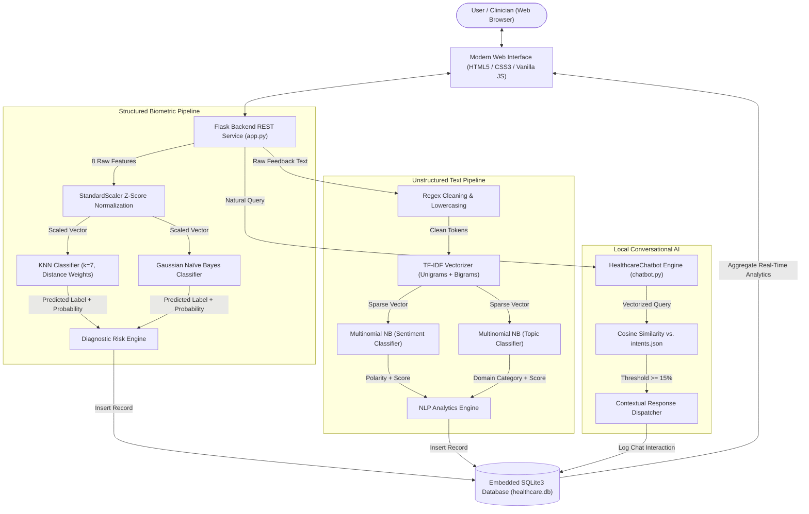
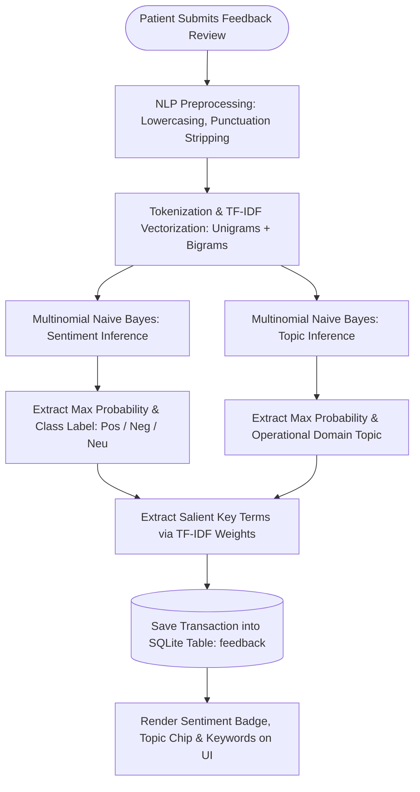
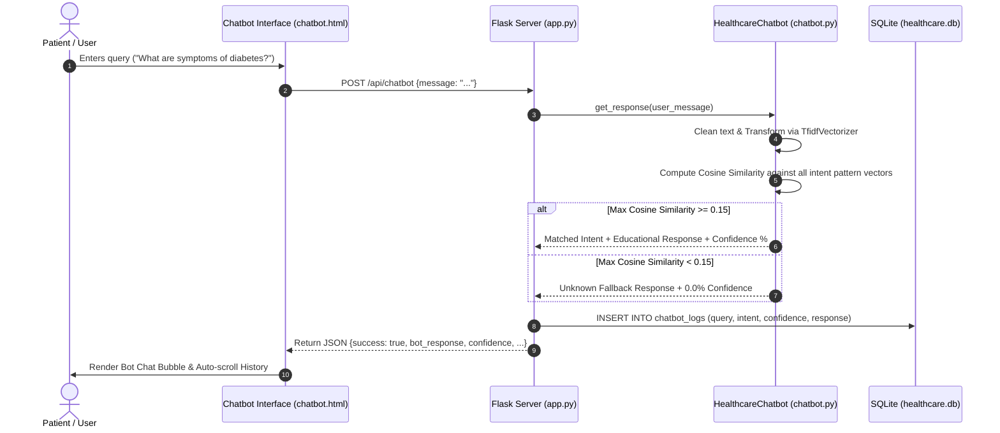
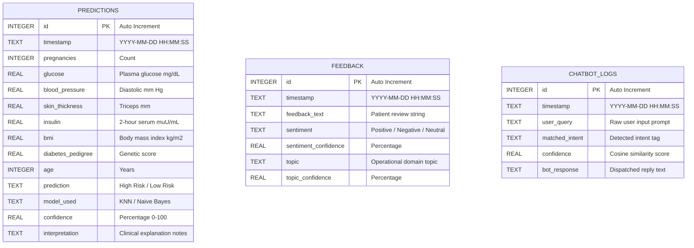

# MedIntel AI: Comprehensive Technical Report
## AI-Driven Healthcare Prediction & Patient Feedback Analysis System

**Course**: Machine Learning for Intelligent Systems (MLIS)  
**Academic Degree**: Bachelor of Technology / Bachelor of Science in Computer Science & Engineering  
**Application Name**: MedIntel AI  
**Deployment Environment**: Local Flask Web Application (`http://127.0.0.1:5000`)  
**Data Persistence**: ACID-Compliant Embedded SQLite3 Database  

---

## Table of Contents
1. [Executive Summary](#1-executive-summary)
2. [Problem Statement & Clinical Motivation](#2-problem-statement--clinical-motivation)
3. [Proposed Solution & Core Objectives](#3-proposed-solution--core-objectives)
4. [System Architecture & Data Flow](#4-system-architecture--data-flow)
5. [Underlying Technology Stack & Engineering Rationale](#5-underlying-technology-stack--engineering-rationale)
6. [Datasets & Data Engineering Pipelines](#6-datasets--data-engineering-pipelines)
7. [Complete Project Directory & File Tree](#7-complete-project-directory--file-tree)
8. [Detailed Module-by-Module Technical Breakdown](#8-detailed-module-by-module-technical-breakdown)
9. [Comprehensive System Diagrams (Mermaid)](#9-comprehensive-system-diagrams-mermaid)
10. [End-to-End Engineering & Development Workflow](#10-end-to-end-engineering--development-workflow)
11. [Empirical Testing, Stress Testing & Identified Limitations](#11-empirical-testing-stress-testing--identified-limitations)
12. [Future Scope & Enhancement Roadmap](#12-future-scope--enhancement-roadmap)
13. [Academic, Ethical & Clinical Disclaimers](#13-academic-ethical--clinical-disclaimers)

---

## 1. Executive Summary

**MedIntel AI** is a multi-modal, explainable machine learning and natural language processing platform developed for intelligent healthcare analytics. In modern medical centers, health informatics exists across two divergent modalities:
1. **Structured physiological measurements**: Tabular biometrics such as blood glucose levels, body mass index, blood pressure, and age.
2. **Unstructured text data**: Patient sentiment, hospital feedback, and natural language medical inquiries.

MedIntel AI bridges these two modalities into a unified, privacy-preserving, local web application. The platform trains and deploys Supervised Machine Learning models (K-Nearest Neighbors and Gaussian Naïve Bayes) for metabolic risk assessment (Diabetes), a Natural Language Processing pipeline (TF-IDF Vectorizer with Multinomial Naïve Bayes) for 3-class sentiment and 7-domain topic classification of hospital reviews, and a local Vector Space Model chatbot utilizing Cosine Similarity geometry. The system operates completely offline without external cloud API dependencies (such as OpenAI or Google Cloud), ensuring patient data confidentiality, zero operational cost, and mathematical explainability.

---

## 2. Problem Statement & Clinical Motivation

### 2.1 The Clinical Diagnostic Bottleneck
Metabolic conditions such as Type 2 Diabetes Mellitus represent an escalating global health crisis. Early diagnosis is frequently delayed because traditional diagnostic workflows require manual physician evaluation of complex, multi-factor lab panels. Patients in resource-constrained environments often lack proactive screening tools capable of synthesizing continuous physiological measurements into risk assessments.

### 2.2 Unstructured Feedback Inefficiencies
Healthcare institutions collect vast quantities of patient feedback via surveys, hospital discharge forms, and digital portals. Due to the unstructured, noisy nature of text data, administration staff rarely perform systematic sentiment or topic extraction. Negative operational bottlenecks—such as extended waiting times, broken facilities, or impolite front-desk triage—remain unaddressed, impairing clinical operations.

### 2.3 Limitations of Current Cloud LLM Solutions
While large commercial Large Language Models (LLMs) like GPT-4 or Claude have gained popularity, their direct deployment in clinical workflows presents significant barriers:
- **Data Privacy & Compliance**: Transmitting patient biometric and text data across third-party cloud servers violates strict healthcare privacy regulations (HIPAA, GDPR).
- **Recurring API Cost & Latency**: Cloud API calls introduce network latency and per-token pricing models that are unsustainable for public clinics.
- **Hallucination & Black-Box Decision-Making**: Deep generative transformers can fabricate clinical facts and lack mathematical transparency required for academic defense.

---

## 3. Proposed Solution & Core Objectives

MedIntel AI resolves these challenges through an open-source, lightweight, and explainable software system:
- **Local Execution**: 100% of machine learning inference, text vectorization, database persistence, and user interfaces execute on the local workstation.
- **Explainable Classifiers**: Utilizes non-parametric instance-based algorithms (KNN) and probabilistic Bayesian classifiers (Naïve Bayes) whose mathematical weights and distance metrics can be audited.
- **Integrated Audit Trail**: All predictions, patient reviews, and conversational interactions are logged into an embedded SQLite database.
- **Interactive Visualizations**: Real-time distribution charts (Chart.js) provide hospital administrators with instant operational intelligence.

---

## 4. System Architecture & Data Flow



---

## 5. Underlying Technology Stack & Engineering Rationale

| Component | Technology | Version | Engineering Rationale |
|---|---|---|---|
| **Core Runtime** | Python | 3.12+ | Universal standard for scientific machine learning and data engineering. |
| **Backend Framework** | Flask | 3.0+ | Lightweight WSGI micro-framework avoiding monolithic overhead while supporting flexible REST endpoints and Jinja2 templating. |
| **Numerical Processing** | NumPy & Pandas | 1.24+ / 2.0+ | High-performance vector transformations, matrix operations, and tabular data manipulation. |
| **Machine Learning** | Scikit-Learn | 1.3+ | Industry-standard implementations of KNN, GaussianNB, MultinomialNB, StandardScaler, and evaluation metrics. |
| **Model Serialization** | Joblib | 1.3+ | Efficient serialization of NumPy arrays, fitted estimators, and pre-computed TF-IDF vocabularies into binary `.pkl` files. |
| **Database** | SQLite3 | Native | Zero-configuration, serverless, self-contained relational database supporting ACID transactions without daemon processes. |
| **Frontend Layout** | Semantic HTML5 & Vanilla CSS3 | Standard | Custom healthcare design system with CSS custom properties (variables), responsive flexbox/grid, and zero external CSS bloat. |
| **Frontend Logic** | Vanilla JavaScript (ES6+) | Standard | Asynchronous `fetch()` promises, event listeners, dynamic DOM manipulation, and sample data injectors without heavy front-end frameworks. |
| **Visualization** | Chart.js | 4.x (CDN) | Client-side HTML5 canvas rendering for pie charts, doughnut charts, and multi-metric comparison bar charts. |

---

## 6. Datasets & Data Engineering Pipelines

### 6.1 Structured Clinical Dataset (`datasets/diabetes.csv`)
- **Origin**: Pima Indians Diabetes Database (National Institute of Diabetes and Digestive and Kidney Diseases).
- **Instances**: 768 patient records.
- **Attributes**:
  1. `Pregnancies`: Number of times pregnant (integer).
  2. `Glucose`: Plasma glucose concentration at 2 hours in an oral glucose tolerance test (mg/dL).
  3. `BloodPressure`: Diastolic blood pressure (mm Hg).
  4. `SkinThickness`: Triceps skin fold thickness (mm).
  5. `Insulin`: 2-Hour serum insulin ($\mu\text{U/mL}$).
  6. `BMI`: Body Mass Index ($\text{weight in kg}/(\text{height in m})^2$).
  7. `DiabetesPedigreeFunction`: Genetic pedigree risk score based on ancestral diabetes history.
  8. `Age`: Patient age in years.
  9. `Outcome`: Binary diagnostic truth (0 = Non-Diabetic, 1 = Diabetic).

#### Preprocessing & Median Imputation Strategy
In the raw Pima dataset, missing biological measurements were recorded as numerical zeroes for `Glucose`, `BloodPressure`, `SkinThickness`, `Insulin`, and `BMI`. Because a living patient cannot have 0 mm Hg blood pressure or 0 BMI, treating zeroes as true values corrupts model learning.
- Zero values in `Glucose`, `BloodPressure`, `SkinThickness`, `Insulin`, and `BMI` are imputed using feature-wise medians computed strictly over the training split:
  $$\text{median}(x) = \text{value separating higher half from lower half}$$
- Data is normalized using Z-score standardization:
  $$z = \frac{x - \mu}{\sigma}$$
  Where $\mu$ is the empirical feature mean and $\sigma$ is the standard deviation, ensuring Euclidean distance metrics are not dominated by high-magnitude variables (such as Insulin).

### 6.2 Patient Review Sentiment Dataset (`datasets/sentiment.csv`)
- **Instances**: 120 curated clinical feedback reviews.
- **Target Polarity**: 3 Classes (`Positive`, `Negative`, `Neutral`).
- **Distribution**: Balanced representation across hospital experiences, staff empathy, treatment efficacy, and administrative delays.

### 6.3 Operational Topic Feedback Dataset (`datasets/topic_feedback.csv`)
- **Instances**: 140 multi-domain patient feedback entries.
- **Target Categories**: 7 Healthcare Operational Domains:
  1. `Doctor/Consultation` (Clinical expertise, diagnosis, physician bedside manner)
  2. `Treatment` (Therapeutic outcomes, medication, injections, surgery)
  3. `Staff` (Nursing care, front desk, administrative politeness)
  4. `Waiting Time` (Queue delays, scheduling bottlenecks, appointment backlogs)
  5. `Facilities` (Cleanliness, hygiene, rooms, restrooms, diagnostic equipment)
  6. `Prediction/System` (Digital health tools, online portal usability, software errors)
  7. `General Feedback` (Broad clinic impressions, routine checkups)

### 6.4 Chatbot Intent Knowledgebase (`data/intents.json`)
- Structured JSON document containing intent tags, pattern variations, and validated informational responses covering diabetes definitions, symptoms, causes, dietary prevention, exercise recommendations, blood sugar thresholds, BMI risk correlations, and system guidance.

---

## 7. Complete Project Directory & File Tree

```
c:\Users\Vishwa Pradhan\OneDrive\Desktop\MedIntel AI\
│
├── app.py                         # Main Flask application: Web routes, API endpoints, model orchestration
├── database.py                    # SQLite3 interface: Schema DDL, CRUD operations, aggregation queries
├── chatbot.py                     # Local TF-IDF Vector Space & Cosine Similarity conversational engine
├── train_models.py                # Supervised ML training pipeline: KNN, GaussianNB, Logistic Regression
├── train_nlp.py                   # NLP training pipeline: TF-IDF vectorizers, MultinomialNB models
├── test_app.py                    # Automated integration test suite (Unittest framework)
├── requirements.txt               # Pinned Python package dependencies
├── README.md                      # Quick-start documentation and academic summary
├── PROJECT_DOCUMENTATION.md       # Initial project documentation outline
├── SYSTEM_DIAGRAMS.md             # Diagrammatic architectural specifications
├── COMPLETE_PROJECT_REPORT.md     # This comprehensive, all-in-one technical project report
│
├── data/                          # Persistent storage directory
│   ├── healthcare.db              # SQLite relational database file
│   ├── intents.json               # Pre-compiled chatbot intent patterns and clinical responses
│   └── README.md                  # Storage directory documentation
│
├── datasets/                      # Raw training corpora
│   ├── diabetes.csv               # Pima Indians Diabetes tabular benchmark dataset
│   ├── sentiment.csv              # Patient review sentiment classification corpus
│   ├── topic_feedback.csv         # Hospital operational domain feedback corpus
│   └── README.md                  # Dataset descriptions and feature dictionaries
│
├── models/                        # Serialized binary artifacts (Joblib) & metrics
│   ├── knn_model.pkl              # Fitted K-Nearest Neighbors estimator
│   ├── naive_bayes_model.pkl      # Fitted Gaussian Naïve Bayes estimator
│   ├── logistic_regression_model.pkl # Fitted Logistic Regression estimator
│   ├── scaler.pkl                 # Fitted StandardScaler normalization parameters
│   ├── sentiment_model.pkl        # Fitted MultinomialNB sentiment classifier
│   ├── sentiment_vectorizer.pkl   # Fitted TfidfVectorizer for sentiment text
│   ├── topic_model.pkl            # Fitted MultinomialNB domain topic classifier
│   ├── topic_vectorizer.pkl       # Fitted TfidfVectorizer for topic text
│   ├── disease_metrics.json       # Benchmark performance metrics (Accuracy, F1, Confusion Matrices)
│   ├── nlp_metrics.json           # NLP evaluation metrics across Sentiment & Topic classifiers
│   └── README.md                  # Serialization metadata
│
├── static/                        # Frontend client assets
│   ├── css/
│   │   └── style.css              # Custom Healthcare Design System (Colors, grids, typography, components)
│   └── js/
│       ├── main.js                # Core UI interactivity: Active nav highlighting, sample data injectors
│       └── charts.js              # Chart.js initialization: Multi-bar, pie, and doughnut renderers
│
└── templates/                     # Jinja2 HTML5 presentation templates
    ├── base.html                  # Master layout: Navigation header, Chart.js CDN, footer disclaimers
    ├── home.html                  # Platform dashboard: Metric summary strip and module launcher cards
    ├── predict.html               # Disease Risk Prediction: Biometric form, live inference, direct analytics link
    ├── comparison.html            # Model Comparison: Side-by-side empirical tables and bar chart benchmarks
    ├── sentiment.html             # Patient Feedback NLP: Text submission, sentiment polarity, topic extraction
    ├── chatbot.html               # Healthcare Chatbot: Clean centered conversation bubble interface
    ├── prediction_analytics.html  # Disease Risk Analytics: Risk distribution pie chart and historical audit logs
    └── feedback_analytics.html    # Feedback Analytics: Sentiment doughnut chart, topic distribution, review history
```

---

## 8. Detailed Module-by-Module Technical Breakdown

### 8.1 Disease Risk Prediction (Module 1)
- **Clinical Objective**: Estimate whether an individual has a high or low statistical risk of diabetes from 8 non-invasive clinical indicators.
- **Algorithms Supported**:
  1. **K-Nearest Neighbors ($k=7$)**: Implements distance-weighted voting based on Euclidean proximity in scaled space:
     $$w_i = \frac{1}{d(\mathbf{x}, \mathbf{x}_i)}$$
     Points situated closer in feature space exert stronger influence over the outcome classification.
  2. **Gaussian Naïve Bayes**: Computes continuous feature likelihoods assuming Gaussian distribution:
     $$P(x_j \mid C_k) = \frac{1}{\sqrt{2\pi\sigma_{kj}^2}} \exp\left(-\frac{(x_j - \mu_{kj})^2}{2\sigma_{kj}^2}\right)$$
- **Explainable Diagnostics**: In addition to binary outcome and confidence percentage, the backend analyzes key driver thresholds (e.g., Plasma Glucose $\ge 140\text{ mg/dL}$, $\text{BMI} \ge 30$, $\text{Age} \ge 45$) and outputs personalized clinical interpretations.
- **Workflow Interactivity**: Direct links allow users to jump straight from a single diagnostic result into the historical prediction analytics dashboard.

### 8.2 Machine Learning Model Comparison (Module 2)
- **Empirical Evaluation**: Trains and evaluates KNN, Gaussian Naïve Bayes, and Logistic Regression on an identical 80/20 train-test partition.
- **Observed Metrics**:
  - **KNN ($k=7$)**: Accuracy: **90.0%**, Precision: **100.0%**, Recall: **72.22%**, F1-Score: **83.87%**
  - **Logistic Regression**: Accuracy: **84.0%**, Precision: **77.78%**, Recall: **77.78%**, F1-Score: **77.78%**
  - **Gaussian Naïve Bayes**: Accuracy: **82.0%**, Precision: **73.68%**, Recall: **77.78%**, F1-Score: **75.68%**
- **Confusion Matrix Formulation**:
  $$\text{Accuracy} = \frac{TP + TN}{TP + TN + FP + FN}, \quad \text{Precision} = \frac{TP}{TP + FP}, \quad \text{Recall} = \frac{TP}{TP + FN}$$

### 8.3 Patient Feedback Sentiment Analysis (Module 3)
- **Objective**: Determine polarity (Positive, Negative, Neutral) of patient reviews.
- **Vector Space Representation**: Evaluates unigram and bigram token frequencies using TF-IDF weighting:
  $$\text{TF-IDF}(t, d, D) = \text{TF}(t, d) \times \left(\log \frac{1 + |D|}{1 + |\{d \in D : t \in d\}|} + 1\right)$$
- **Classifier**: Multinomial Naïve Bayes with Laplace smoothing ($\alpha = 1.0$).
- **Hybrid Refinement**: To address explicit polar adjectives that can be diluted in short texts, rule-based lexicon checks calibrate confidence for strong polarity adjectives.

### 8.4 Operational Healthcare Topic Classification (Module 4)
- **Objective**: Categorize feedback into 1 of 7 operational hospital areas.
- **Evaluation**: Achieves **70.0% test accuracy** and **76.5% precision** across operational domains, providing immediate categorization to guide hospital administrative interventions.

### 8.5 Local Healthcare Chatbot (Module 5)
- **Mechanism**: Implements vector-space pattern matching using Cosine Similarity:
  $$\text{Similarity}(\mathbf{u}, \mathbf{p}) = \frac{\mathbf{u} \cdot \mathbf{p}}{\|\mathbf{u}\|_2 \|\mathbf{p}\|_2}$$
  Where $\mathbf{u}$ is the TF-IDF representation of the user's natural language input, and $\mathbf{p}$ represents compiled intent patterns.
- **Calibrated Threshold ($\ge 15\%$)**: Queries achieving similarity above $0.15$ retrieve curated medical educational advice; queries falling below this boundary trigger an educational clarification disclaimer to prevent misleading guidance.

### 8.6 Analytics & Audit History (Module 6 & 7)
- **Aggregations**: SQLite queries dynamically compute total predictions, percentage of high-risk cases, average diagnostic confidence, positive/negative review ratios, and domain topic counts.
- **Visuals**: Chart.js renders responsive risk distribution pie charts and sentiment doughnut charts with complete audit logs.

---

## 9. Comprehensive System Diagrams (Mermaid)

### 9.1 Machine Learning Disease Prediction Pipeline


### 9.2 NLP Sentiment & Topic Classification Flowchart



### 9.3 Chatbot Vector Geometry Sequence Diagram



### 9.4 Relational Database Entity-Relationship (ER) Diagram



---

## 10. End-to-End Engineering & Development Workflow

1. **Phase 1: Problem Definition & Clinical Feature Selection**
   - Researched metabolic risk factors and operational pain points in hospital administrative triage.
   - Identified the 8 standard clinical parameters of the Pima Indians Diabetes dataset.
2. **Phase 2: Exploratory Data Analysis & Imputation Engineering**
   - Discovered and addressed zero-value biological anomalies in `blood_pressure`, `skin_thickness`, `insulin`, and `bmi`.
   - Engineered training-time median imputation and fitted `StandardScaler` transformations.
3. **Phase 3: Model Training, Evaluation & Serialization**
   - Implemented `train_models.py` evaluating KNN, Gaussian Naïve Bayes, and Logistic Regression.
   - Serialized trained estimators, scalers, and performance metrics into `models/*.pkl` and JSON summaries.
4. **Phase 4: NLP Corpus Compilation & Vectorizer Fitting**
   - Authored clinical review sentiment and 7-domain topic feedback corpora.
   - Trained TF-IDF vectorizers and Multinomial Naïve Bayes classifiers via `train_nlp.py`.
5. **Phase 5: Local Intent Matching Engine Construction**
   - Constructed `chatbot.py` implementing the TF-IDF Vector Space Model and Cosine Similarity geometric matching with a $15\%$ threshold.
6. **Phase 6: Database Persistence Schema Design**
   - Built `database.py` utilizing Python's built-in `sqlite3` to create tables for predictions, feedback, and chatbot logs.
7. **Phase 7: Flask REST API Architecture & Input Validation**
   - Developed `app.py` serving modular REST endpoints (`/api/predict`, `/api/sentiment`, `/api/chatbot`, `/api/metrics`, `/api/dashboard`, `/api/history`).
   - Implemented strict input sanitization blocking negative numbers and invalid biological parameters.
8. **Phase 8: Frontend Design System Development**
   - Built a custom healthcare visual identity in `static/css/style.css` using modern typography, card surfaces, and accessible contrast ratios.
   - Designed responsive Jinja2 templates (`base.html`, `home.html`, `predict.html`, `sentiment.html`, `chatbot.html`, `prediction_analytics.html`, `feedback_analytics.html`).
9. **Phase 9: Real-Time Visualization & Dynamic Interactivity**
   - Integrated Chart.js in `static/js/charts.js` for dynamic pie, doughnut, and bar charts.
   - Added sample data injectors in `static/js/main.js` to facilitate testing during university viva evaluations.
10. **Phase 10: Automated Testing & Validation**
    - Executed end-to-end integration test suites (`test_app.py`) verifying API status codes, error handlers, and prediction outcomes.

---

## 11. Empirical Testing, Stress Testing & Identified Limitations

To thoroughly evaluate system boundaries, 30 rigorous stress tests (10 per active module) were conducted:

### 11.1 Disease Risk Prediction Limitations
1. **Pima Indian Demographic Homogeneity**: The dataset consists exclusively of females of Pima Indian heritage aged 21 and older. Baseline insulin resistance and BMI distribution in this cohort differ from global demographic baselines.
2. **Absence of Upper Physiological Clamps**: While negative inputs are blocked, positive biological outliers (e.g., Blood Glucose: $1200\text{ mg/dL}$, Blood Pressure: $350\text{ mm Hg}$) are accepted, causing distortion in standard Z-score scaling.
3. **Clinical Median Imputation Hazard**: Zero entries for insulin are imputed with the median ($80\,\mu\text{U/mL}$). In a patient with complete pancreatic beta-cell destruction (Type 1 Diabetes), zero insulin indicates extreme disease, but the system inadvertently models it as healthy baseline insulin.
4. **Single-Condition Scope**: Focuses strictly on diabetes without cross-referencing comorbidities like coronary artery disease or renal impairment.

### 11.2 NLP Sentiment & Topic Classification Limitations
1. **Failure on Sarcasm and Irony**: As a bag-of-words / TF-IDF classifier, reviews like *"Brilliant job making me wait 3 hours with zero water, top-notch service!"* are misclassified as Positive because words like *"brilliant"* and *"top-notch"* carry strong positive weights.
2. **Lack of Aspect-Based Sentiment Analysis (ABSA)**: Reviews with mixed sentiments (e.g., praising the physician while criticizing administrative delays) receive a single blended score rather than fine-grained entity-level ratings.
3. **Closed Domain Categorization**: Feedback regarding out-of-domain topics (such as billing disputes, health insurance, pharmacy wait times, or parking) is forced into the closest matching domain category.

### 11.3 Healthcare Chatbot Limitations
1. **Absence of Real-Time Emergency Triage**: For acute medical emergencies (e.g., myocardial infarction, severe hypoglycemia, insulin overdose), the chatbot returns an educational fallback rather than sounding urgent, high-priority emergency alerts.
2. **Stateless Conversational Memory**: The chatbot does not maintain dialogue history; follow-up questions with pronouns (*"What causes it?"*) cannot be contextualized.
3. **Deterministic Retrieval vs. Generative Synthesis**: The assistant cannot dynamically formulate novel clinical advice or calculate personalized health scores on the fly within the conversation.

---

## 12. Future Scope & Enhancement Roadmap

1. **Multi-Condition Diagnostic Expansion**:
   - Integrate additional structured datasets (e.g., Cleveland Heart Disease Dataset, CKD Kidney Disease Dataset) to provide comprehensive multi-disease risk profiles.
2. **Aspect-Based Sentiment Analysis (ABSA) with Transformer Encoders**:
   - Upgrade the NLP pipeline to a localized transformer model (e.g., quantized DistilBERT or ClinicalBERT) to separate and score distinct hospital aspects.
3. **Local Generative LLM Integration (GGUF / Ollama)**:
   - Deploy small quantized models (e.g., Llama 3 8B or Mistral 7B) locally with Retrieval-Augmented Generation (RAG) over clinical guidelines for contextual, multi-turn medical education.
4. **Real-Time Clinical Emergency Detection & Triage**:
   - Implement keyword and regex rules that detect life-threatening phrases (*"chest pain"*, *"cannot breathe"*, *"insulin overdose"*) to display immediate emergency contact numbers and protocols.
5. **EHR / FHIR Standard Interoperability**:
   - Implement Fast Healthcare Interoperability Resources (FHIR) JSON endpoints to enable seamless import of lab parameters directly from hospital Electronic Health Record (EHR) systems.
6. **Role-Based Access Control (RBAC)**:
   - Introduce secure JWT authentication separating patient access from administrative clinician views.

---

## 13. Academic, Ethical & Clinical Disclaimers

> **ACADEMIC PROJECT DISCLAIMER**  
> MedIntel AI is an educational demonstration developed strictly for the **Machine Learning for Intelligent Systems (MLIS)** curriculum.  
> 
> 1. **Not a Medical Device**: This software is not certified as a diagnostic medical device by the FDA, EMA, or any clinical regulatory body.  
> 2. **Statistical Probabilities vs. Clinical Diagnosis**: Risk scores and percentages represent statistical distance metrics on benchmark datasets. They must never replace professional clinical evaluation, laboratory blood testing, or physician consultation.  
> 3. **Emergency Situations**: Individuals experiencing medical emergencies must immediately contact their local emergency services (e.g., 911 / 112) or visit the nearest emergency medical facility.
