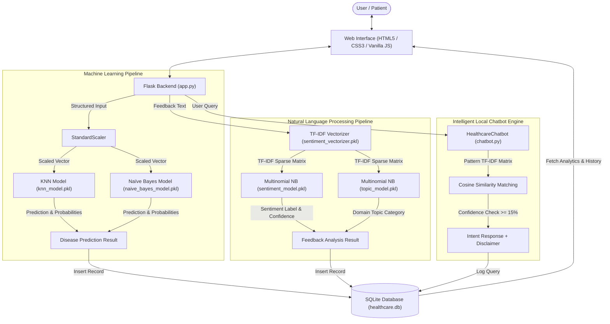
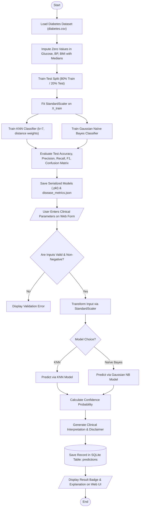
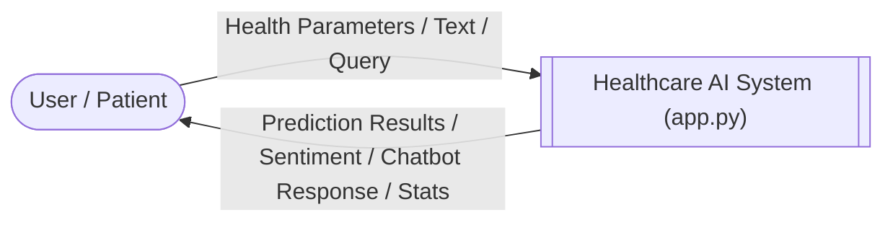
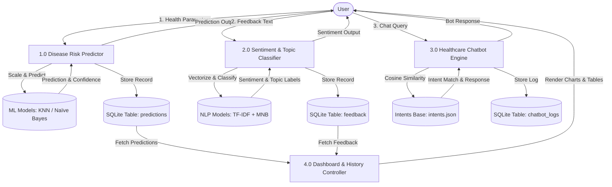
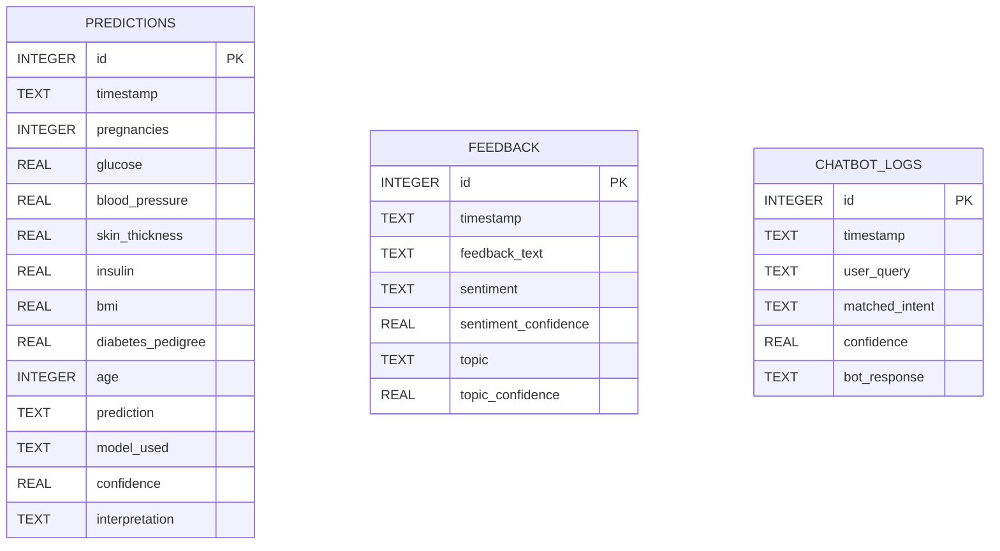

# System Architecture & Academic Diagrams

This document contains complete diagrammatic representations matching the exact implementation of the **AI-Driven Healthcare Prediction & Patient Feedback Analysis System**.

---

## 1. System Architecture Diagram

---

## 2. Machine Learning Flowchart (Disease Prediction)

---

## 3. NLP Flowchart (Sentiment & Topic Classification)

---

## 4. Chatbot Flowchart (Local Intent Engine)

---

## 5. Use Case Diagram

```mermaid
gantt
    title Use Case Interaction Diagram
    dateFormat  X
    axisFormat %s

    section User Actions
    Disease Risk Prediction       :active, u1, 0, 1
    Model Comparison Overview    :active, u2, 1, 2
    Feedback Sentiment Analysis   :active, u3, 2, 3
    Interactive Chatbot Query     :active, u4, 3, 4
    View Dashboard & Log History :active, u5, 4, 5

    section System Responses
    ML Scaling & Inference        :active, s1, 0, 1
    Render Metrics & Bar Chart    :active, s2, 1, 2
    TF-IDF Vectorization & MNB    :active, s3, 2, 3
    Cosine Similarity Intent      :active, s4, 3, 4
    SQLite Database Query         :active, s5, 4, 5
```

---

## 6. Data Flow Diagram Level 0 (Context Diagram)

---

## 7. Data Flow Diagram Level 1

---

## 8. Entity-Relationship (ER) Diagram

