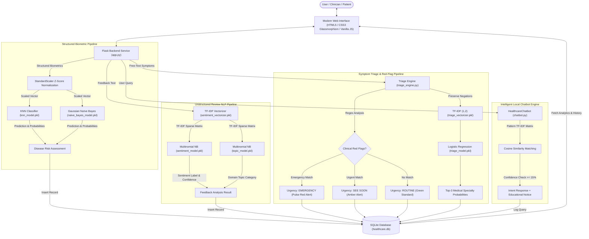
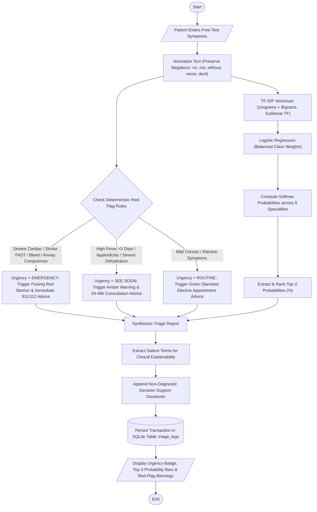
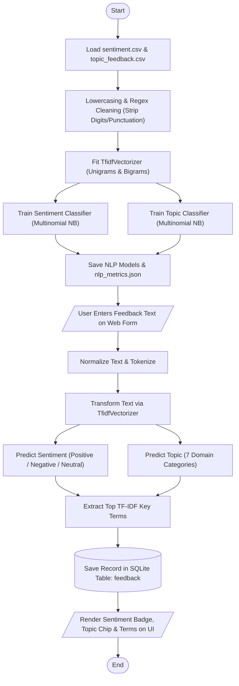
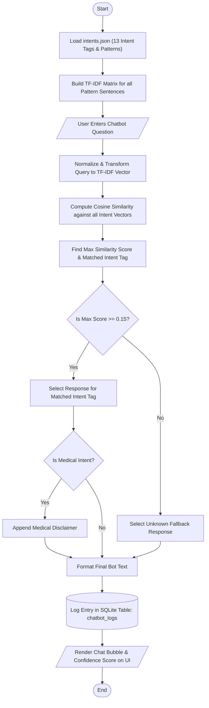
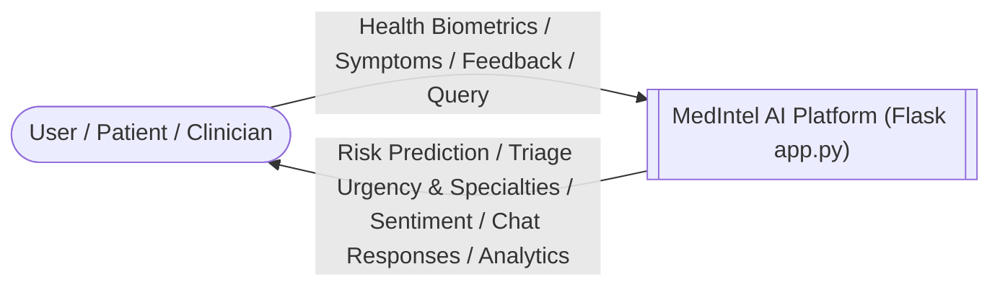
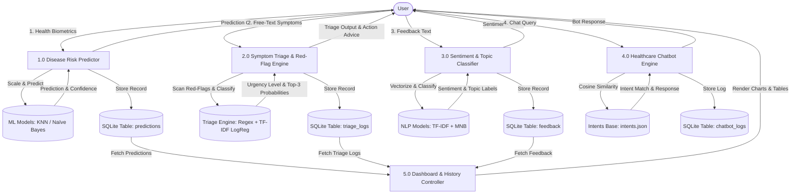
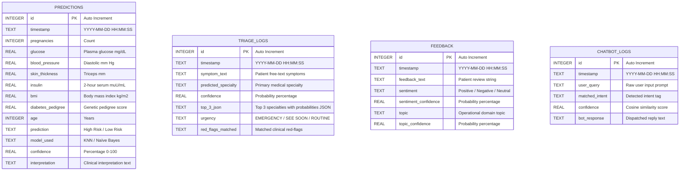

# System Architecture & Academic Diagrams

This document contains complete diagrammatic representations matching the exact implementation of the **MedIntel AI: AI-Driven Healthcare Prediction, Feedback Analysis & Symptom Triage Platform**.

---

## 1. System Architecture Diagram

---

## 2. Machine Learning Flowchart (Disease Prediction)

---

## 3. Symptom Triage & Red-Flag Clinical Flowchart

---

## 4. NLP Flowchart (Feedback Sentiment & Topic Classification)

---

## 5. Chatbot Flowchart (Local Intent Engine)

---

## 6. Data Flow Diagram Level 0 (Context Diagram)

---

## 7. Data Flow Diagram Level 1

---

## 8. Entity-Relationship (ER) Diagram

